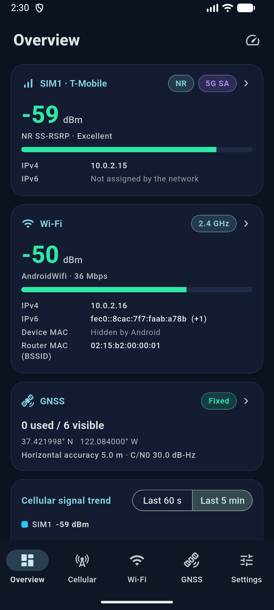

<div align="center">


# SignalScope

**An Android network-signal inspector built with Flutter and Kotlin.**
SIM and carrier info, LTE / 5G NR cellular signal, Wi-Fi and nearby access points, GNSS satellites, and a TCP / DNS latency test.

[简体中文](README_zh.md) | English

[](https://github.com/lwh0630/SignalScope/actions/workflows/flutter-ci.yml)
[](https://creativecommons.org/licenses/by-nc-sa/4.0/)
-3DDC84?logo=android&logoColor=white)


</div>

> **Core principle: only show values the system actually reports.** There is no random or hard-coded data in real mode. A field the system does not provide is `null` and shown as `--`, never as `0`. No hidden APIs, no reflection, no root.

## Table of Contents

- [Features](#features)
- [Screenshots](#screenshots)
- [Tech Stack](#tech-stack)
- [Android Compatibility](#android-compatibility)
- [Permissions](#permissions)
- [Install and Run](#install-and-run)
- [Build from Source](#build-from-source)
- [Project Structure](#project-structure)
- [Development Status](#development-status)
- [Contributing](#contributing)
- [License](#license)
- [Acknowledgements](#acknowledgements)

## Features

| Page | What it shows |
| --- | --- |
| **Overview** | Per-SIM carrier, network type, primary signal and IPv4 / IPv6; Wi-Fi state with IPv4 / IPv6 / MAC; GNSS state; cellular and Wi-Fi trend charts. Tap a card for details. The speed icon at the top right opens the latency test. |
| **Cellular** | Independent state for each SIM (SIM1 / SIM2 switch). SIM, carrier, MCC/MNC, roaming, data state. LTE: RSRP / RSRQ / RSSI / SINR / CQI / TA, PCI, TAC, CI, eNodeB ID, EARFCN, band, bandwidth. NR: SS / CSI RSRP / RSRQ / SINR, PCI, TAC, NCI, NRARFCN, band. NSA / SA detection, neighbor cells, 60 s / 5 min trends. |
| **Wi-Fi** | Current connection (SSID, router MAC, RSSI, frequency, channel, width, link speed, IPv4 / IPv6, device MAC, gateway, DNS, security, standard), nearby access points (band filter, sorting), 2.4 / 5 / 6 GHz channel graph (tap for details), RSSI trend. |
| **GNSS** | Fix status, latitude / longitude, altitude, accuracy, speed, TTFF; visible / used-in-fix / tracked satellite counts; constellation breakdown with country / organization flags; sky plot; C/N0 bar chart grouped by constellation; satellite list; C/N0 and satellite-count trends. |
| **Latency test** | DNS time plus TCP-handshake timing (min / avg / max, jitter, loss) against built-in site lists (Mainland China, US / international) and up to 20 custom targets. |
| **Settings** | Theme (dark-first / light / system), language (Chinese / English / system), refresh rate, history window, CSV / JSON export, clear history, permission manager, demo mode, about. |

Also: multi-SIM support with per-subscription isolation, event-driven sensing (no polling), and a session-only **demo mode** with a visible banner and clearly fictional data.

Notable limits (all explained in the app):

- Normal apps cannot send ICMP ping, so the latency test measures a TCP handshake (close to, but not the same as, ping).
- Android 10+ hides the real device MAC from normal apps; the app shows `--` instead of the `02:00:00:00:00:00` placeholder.
- Wi-Fi scanning is throttled by Android; the app does not try to bypass it.
- Availability of NR / NSA fields, neighbor cells, bands and bandwidth depends on the device's modem and vendor.

## Screenshots

<p align="center">
  
</p>

> The screenshot was taken in the Android Emulator. The carrier, addresses, location and signal values are simulated by the emulator, not measured on a real device. Screenshots of the other pages are not published yet.

## Tech Stack

| Area | Choice |
| --- | --- |
| Framework | Flutter 3.47.x, Dart ^3.13.5 |
| UI | Material 3, custom `CustomPainter` charts, `fl_chart` |
| State management | Riverpod 3.x (`flutter_riverpod`) |
| Localization | `flutter_localizations`, `intl`, built-in zh / en string table |
| Native layer | Kotlin (Android): `TelephonyManager`, `WifiManager`, `LocationManager` / `GnssStatus`, `ConnectivityManager` |
| Bridge | One `MethodChannel` and four `EventChannel`s. **No Flutter plugins** are used. |
| Build | Android Gradle Plugin 9.1.0, Kotlin 2.4.0, Gradle 9.3.1 |
| Tests | `flutter_test`, 99 unit / widget tests |

Architecture: feature-first folders with a Repository layer; a `SignalPlatform` abstraction (`AndroidPlatform`, `UnsupportedPlatform`, `DemoPlatform`) is the only boundary to the device. See [`AGENTS.md`](AGENTS.md) for details.

## Android Compatibility

- **Minimum:** Android 10 (API 29). `compileSdk` / `targetSdk` follow the Flutter default (API 36).
- Some data depends on the OS version:

| Capability | Requirement |
| --- | --- |
| `TelephonyCallback` listeners | API 31+ (API 29 / 30 fall back to `PhoneStateListener`) |
| LTE bands from `CellIdentityLte.getBands()` | API 30+ (NR: API 29+); otherwise only a unique EARFCN lookup, labeled as computed |
| Per-SIM mobile IP address matching | API 31+ (`NetworkCapabilities.getSubscriptionIds()`); older versions only identify the current data SIM |
| `NEARBY_WIFI_DEVICES` runtime permission | API 33+ |
| Baseband C/N0 for satellites | API 30+ |

- **Windows** builds are a **UI shell only**: the pages run and settings / export work, but cellular, Wi-Fi and GNSS collection is not implemented there (the app shows "not supported", never fake data).
- iOS, macOS, Linux and Web are not supported.

## Permissions

| Permission | Purpose |
| --- | --- |
| `READ_PHONE_STATE` | SIM, carrier, cellular signal |
| `ACCESS_FINE_LOCATION` / `ACCESS_COARSE_LOCATION` | Cell identity, Wi-Fi names and scan results, GNSS |
| `NEARBY_WIFI_DEVICES` (Android 13+) | Nearby Wi-Fi scan results |
| `ACCESS_WIFI_STATE`, `CHANGE_WIFI_STATE`, `ACCESS_NETWORK_STATE` | Wi-Fi state; `CHANGE_WIFI_STATE` is used only when you tap "Scan" |
| `INTERNET` | Latency test only; connects only after you tap start; no data is uploaded |

The app does not place calls, read call logs, or upload any data. Telephony, Wi-Fi and GPS hardware features are declared `required=false`, so devices without them can still install the app and the matching pages show "not supported".

## Install and Run

There is **no published release yet**. Build the APK yourself (see below) and install it on an Android 10+ device:

```bash
adb install build/app/outputs/flutter-apk/app-arm64-v8a-release.apk
```

Or run directly on a connected device or emulator:

```bash
flutter run -d <device-id>
```

> Release builds are signed with the maintainer's release key, which is **not** in this repository. Building a release yourself requires your own signing key (see "Release signing" below); debug builds need no setup.

## Build from Source

Prerequisites: Flutter 3.47.x (Dart 3.13), JDK 17+ (the Android Studio JBR works), Android SDK.

```bash
git clone https://github.com/lwh0630/SignalScope.git
cd SignalScope

flutter pub get
flutter analyze
flutter test

# Debug
flutter run -d <android-device>

# Release APKs, one per ABI
flutter build apk --release --split-per-abi
# -> build/app/outputs/flutter-apk/app-<abi>-release.apk
```

### Release signing

A release build never falls back to the debug key: without signing material, `flutter build apk --release` fails with an explanatory message. Provide your own key either through a git-ignored `android/key.properties`:

```properties
storeFile=C:/path/outside/the/repo/release.jks
storePassword=...
keyPassword=...
keyAlias=...
```

or through the environment variables `ANDROID_KEYSTORE_PATH`, `ANDROID_STORE_PASSWORD`, `ANDROID_KEY_PASSWORD` and `ANDROID_KEY_ALIAS` (environment variables take precedence). Never commit the keystore or these values.

The [Android Release workflow](.github/workflows/android-release.yml) runs when a `v*.*.*` tag is pushed or when started manually. It reads the keystore from the `production` environment secrets, builds one APK per ABI, verifies the signing certificate with `apksigner`, and creates a **draft** GitHub Release; nothing is published automatically.

The Windows UI shell needs Visual Studio with "Desktop development with C++":

```bash
flutter run -d windows
```

Android Studio creates `android/local.properties` with your SDK paths. It is local only and git-ignored.

## Project Structure

```
lib/
  core/            theme, i18n (zh / en), history ring buffer, lifecycle, throttling, utils
  data/
    models/        SimInfo, CellularInfo, WifiConnectionInfo, GnssSnapshot, ...
    platform/      SignalPlatform + Android / Unsupported / Demo implementations
  features/        overview, cellular, wifi, gnss, latency, settings, permissions,
                   export, shell, monitoring      (data / application / presentation)
  shared/widgets/  cards, gauges, trend charts, monitor bar, address widgets
android/app/src/main/kotlin/com/signalscope/app/
                   MainActivity, NativeChannelHandler, PermissionService, SimInfoService,
                   CellularService, WifiSignalService, GnssService, NetworkAddresses,
                   ExportService, NativeUtils
assets/branding/   app icon sources and generator script
test/              unit and widget tests
```

## Development Status

- Implemented and covered by automated tests (`flutter test`): data parsing ("missing means `null`"), controllers and lifecycle, charts' geometry, latency statistics, i18n key parity, export formats, demo data.
- **Not yet verified on a wide range of real hardware.** The app has not been fully validated on real multi-SIM 5G devices; NR / NSA field availability depends strongly on the vendor modem.
- The Windows target is a UI shell only.
- [GitHub Actions CI](.github/workflows/flutter-ci.yml) checks formatting, runs `flutter analyze` and `flutter test`, and builds a debug APK on every push and pull request to `main`. There is no published release yet; the separate Android Release workflow creates signed draft releases on demand (see "Release signing").


## Contributing

Issues and pull requests are welcome, within the license terms below.

1. Read [`AGENTS.md`](AGENTS.md) for architecture and conventions (also useful for human contributors).
2. Keep changes small and focused; do not add dependencies without a reason.
3. Use only public Android APIs and never fake signal data.
4. Run `dart format lib test`, `flutter analyze` and `flutter test` before opening a pull request, and say which checks you ran.
5. Update both `README.md` and `README_zh.md` when you change features, permissions or build steps.

By contributing you agree that your contribution is licensed under the same terms as this project (CC BY-NC-SA 4.0).

## License

This project is licensed under the [Creative Commons Attribution-NonCommercial-ShareAlike 4.0 International License (CC BY-NC-SA 4.0)](https://creativecommons.org/licenses/by-nc-sa/4.0/).

- You may study, copy and modify the project for **non-commercial** purposes.
- You must give appropriate credit, indicate changes, and share adaptations under the same license.
- Commercial use beyond what the license allows requires separate permission from the copyright holder.

See [`LICENSE`](LICENSE) (full legal text), [`NOTICE`](NOTICE) and [`ATTRIBUTION.md`](ATTRIBUTION.md) (attribution policy, including an optional, non-mandatory request for derivative projects).

> Note: Creative Commons itself does not recommend using its licenses for software source code. This project uses CC BY-NC-SA 4.0 by the maintainer's explicit choice. Dependencies (Flutter, Dart, and the packages in `pubspec.yaml`) keep their own licenses.

## Acknowledgements

- [Flutter](https://flutter.dev) and [Dart](https://dart.dev)
- [Riverpod](https://riverpod.dev) for state management
- [fl_chart](https://pub.dev/packages/fl_chart) for charts
- The Android platform APIs (`TelephonyManager`, `WifiManager`, `LocationManager`, `ConnectivityManager`)
