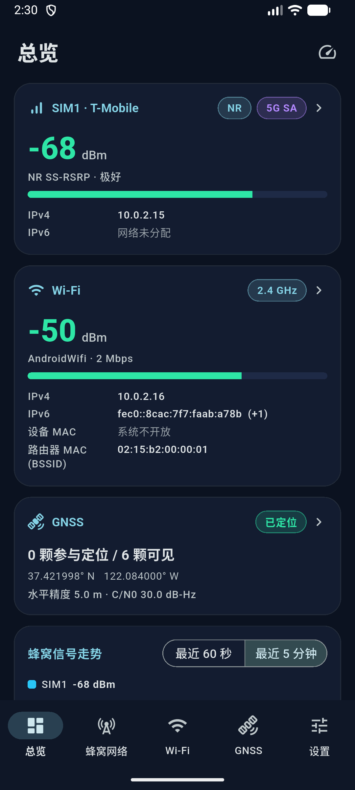

<div align="center">


# SignalScope

**基于 Flutter 与 Kotlin 的 Android 网络信号检测应用。**
SIM 与运营商信息、LTE / 5G NR 蜂窝信号、Wi-Fi 与附近热点、GNSS 卫星，以及 TCP / DNS 延迟测试。

简体中文 | [English](README.md)

[](https://creativecommons.org/licenses/by-nc-sa/4.0/)
-3DDC84?logo=android&logoColor=white)


</div>

> **核心原则：只显示系统真实返回的值。** 真实模式下没有随机数，也没有写死的假数据。系统不提供的字段为 `null`，界面显示 `--`，**绝不用 0 顶替**。不使用隐藏 API、反射或 root。

## 目录

- [功能](#功能)
- [截图](#截图)
- [技术栈](#技术栈)
- [Android 兼容性](#android-兼容性)
- [权限](#权限)
- [安装与运行](#安装与运行)
- [从源码构建](#从源码构建)
- [项目结构](#项目结构)
- [开发状态](#开发状态)
- [参与贡献](#参与贡献)
- [许可证](#许可证)
- [致谢](#致谢)

## 功能

| 页面 | 内容 |
| --- | --- |
| **总览** | 每张 SIM 的运营商、网络类型、主信号和 IPv4 / IPv6；Wi-Fi 状态与 IPv4 / IPv6 / MAC；GNSS 状态；蜂窝与 Wi-Fi 走势图。点击卡片进入详情。右上角的测速图标进入延迟测试。 |
| **蜂窝网络** | 双卡各自独立状态（SIM1 / SIM2 切换）。SIM、运营商、MCC/MNC、漫游、数据状态。LTE：RSRP / RSRQ / RSSI / SINR / CQI / TA、PCI、TAC、CI、eNodeB ID、EARFCN、频段、带宽。NR：SS / CSI RSRP / RSRQ / SINR、PCI、TAC、NCI、NRARFCN、频段。NSA / SA 判定、邻区列表、60 秒 / 5 分钟走势。 |
| **Wi-Fi** | 当前连接（SSID、路由器 MAC、RSSI、频率、信道、频宽、连接速率、IPv4 / IPv6、设备 MAC、网关、DNS、安全类型、Wi-Fi 标准）、附近热点（频段过滤、排序）、2.4 / 5 / 6 GHz 信道图（点选看详情）、RSSI 走势。 |
| **GNSS** | 定位状态、经纬度、海拔、精度、速度、TTFF；可见 / 参与定位 / 已跟踪卫星数；带所属国家 / 组织国旗的星座分布；天空图；按星座分组的 C/N0 柱状图；卫星列表；C/N0 与卫星数走势。 |
| **延迟测试** | DNS 解析时间 + TCP 握手计时（最小 / 平均 / 最大、抖动、丢包），内置站点分组（中国大陆、美国 / 国际），并支持最多 20 个自定义目标。 |
| **设置** | 主题（深色优先 / 浅色 / 跟随系统）、语言（中文 / English / 跟随系统）、刷新频率、历史窗口、CSV / JSON 导出、清空历史、权限管理、演示模式、关于。 |

另外：多卡支持（按订阅 ID 隔离）、事件驱动采集（不轮询），以及仅限当前会话的**演示模式**（带醒目横幅，数据明确为虚构）。

主要限制（应用内均有说明）：

- 普通应用不能发送 ICMP ping，延迟测试测量的是 TCP 握手时间，接近但不等于 ping。
- Android 10 起普通应用无法获取设备真实 MAC，界面显示 `--`，不会显示占位值 `02:00:00:00:00:00`。
- Wi-Fi 扫描受 Android 节流限制，应用不会绕过。
- NR / NSA 字段、邻区、频段、带宽是否有值取决于设备基带与厂商实现。

## 截图

<p align="center">
  
</p>

> 截图来自 Android 模拟器，运营商、地址、位置和信号数值均由模拟器模拟，并非真机实测。其他页面的截图暂未发布。

## 技术栈

| 方面 | 选型 |
| --- | --- |
| 框架 | Flutter 3.47.x，Dart ^3.13.5 |
| UI | Material 3、自绘 `CustomPainter` 图表、`fl_chart` |
| 状态管理 | Riverpod 3.x（`flutter_riverpod`） |
| 本地化 | `flutter_localizations`、`intl`、内置中 / 英词条表 |
| 原生层 | Kotlin（Android）：`TelephonyManager`、`WifiManager`、`LocationManager` / `GnssStatus`、`ConnectivityManager` |
| 桥接 | 一个 `MethodChannel` 与四个 `EventChannel`。**不使用任何 Flutter 插件。** |
| 构建 | Android Gradle Plugin 9.1.0、Kotlin 2.4.0、Gradle 9.3.1 |
| 测试 | `flutter_test`，99 个单元 / 组件测试 |

架构：按功能分目录 + Repository 分层；`SignalPlatform` 抽象（`AndroidPlatform`、`UnsupportedPlatform`、`DemoPlatform`）是与设备交互的唯一边界。详见 [`AGENTS.md`](AGENTS.md)（英文）。

## Android 兼容性

- **最低版本：** Android 10（API 29）。`compileSdk` / `targetSdk` 取 Flutter 默认值（API 36）。
- 部分数据取决于系统版本：

| 能力 | 要求 |
| --- | --- |
| `TelephonyCallback` 监听 | API 31+（API 29 / 30 回退到 `PhoneStateListener`） |
| `CellIdentityLte.getBands()` 提供 LTE 频段 | API 30+（NR 为 API 29+）；否则仅在 EARFCN 对应唯一频段时推导，并标注“计算值” |
| 按 SIM 匹配移动网络 IP | API 31+（`NetworkCapabilities.getSubscriptionIds()`）；更低版本只能确定当前数据卡 |
| `NEARBY_WIFI_DEVICES` 运行时权限 | API 33+ |
| 卫星基带 C/N0 | API 30+ |

- **Windows** 仅为**界面外壳**：页面可运行，设置与导出可用，但蜂窝、Wi-Fi、GNSS 采集未在该平台实现（界面显示“当前平台不支持”，不会显示假数据）。
- 不支持 iOS、macOS、Linux 与 Web。

## 权限

| 权限 | 用途 |
| --- | --- |
| `READ_PHONE_STATE` | SIM、运营商、蜂窝信号 |
| `ACCESS_FINE_LOCATION` / `ACCESS_COARSE_LOCATION` | 小区标识、Wi-Fi 名称与扫描结果、GNSS |
| `NEARBY_WIFI_DEVICES`（Android 13+） | 附近 Wi-Fi 扫描结果 |
| `ACCESS_WIFI_STATE`、`CHANGE_WIFI_STATE`、`ACCESS_NETWORK_STATE` | 读取 Wi-Fi 状态；`CHANGE_WIFI_STATE` 仅在你点击“扫描”时使用 |
| `INTERNET` | 仅用于延迟测试；只在你点击开始后才联网；不上传任何数据 |

应用不拨打电话、不读取通话记录、不上传任何数据。电话、Wi-Fi、GPS 硬件特性在清单中均为 `required=false`，没有这些硬件的设备也能安装，对应页面显示“设备不支持”。

## 安装与运行

**目前没有已发布的版本。** 请按下文自行构建 APK，并安装到 Android 10+ 设备：

```bash
adb install build/app/outputs/flutter-apk/app-arm64-v8a-release.apk
```

或者直接在已连接的设备 / 模拟器上运行：

```bash
flutter run -d <device-id>
```

> 目前的发布构建使用 Flutter 默认的 **debug** 签名，仅用于自测。分发前请配置你自己的签名。

## 从源码构建

环境：Flutter 3.47.x（Dart 3.13）、JDK 17+（Android Studio 自带 JBR 亦可）、Android SDK。

```bash
git clone https://github.com/lwh0630/SignalScope.git
cd SignalScope

flutter pub get
flutter analyze
flutter test

# 调试
flutter run -d <android 设备>

# 发布 APK（按 ABI 拆分）
flutter build apk --release --split-per-abi
# -> build/app/outputs/flutter-apk/app-<abi>-release.apk
```

Windows 界面外壳需要安装 Visual Studio 的“使用 C++ 的桌面开发”：

```bash
flutter run -d windows
```

Android Studio 会生成包含 SDK 路径的 `android/local.properties`，该文件只在本地使用，已被 git 忽略。

## 项目结构

```
lib/
  core/            主题、i18n（中 / 英）、历史环形缓冲、生命周期、节流、工具
  data/
    models/        SimInfo、CellularInfo、WifiConnectionInfo、GnssSnapshot ...
    platform/      SignalPlatform 及 Android / Unsupported / Demo 实现
  features/        overview、cellular、wifi、gnss、latency、settings、permissions、
                   export、shell、monitoring        （data / application / presentation）
  shared/widgets/  卡片、仪表盘、走势图、监听条、地址组件
android/app/src/main/kotlin/com/signalscope/app/
                   MainActivity、NativeChannelHandler、PermissionService、SimInfoService、
                   CellularService、WifiSignalService、GnssService、NetworkAddresses、
                   ExportService、NativeUtils
assets/branding/   应用图标源文件与生成脚本
test/              单元与组件测试
```

## 开发状态

- 已实现并有自动化测试覆盖（`flutter test`）：数据解析（“缺失即 `null`”）、控制器与生命周期、图表几何、延迟统计、中英词条一致性、导出格式、演示数据。
- **尚未在大量真实设备上验证。** 未在真实多卡 5G 设备上做完整验证；NR / NSA 字段是否可用强烈依赖厂商基带。
- Windows 目标仅为界面外壳。
- 目前没有 CI、没有已发布版本，也没有发布签名配置。


## 参与贡献

欢迎提交 issue 与 pull request，须遵守下方许可证条款。

1. 阅读 [`AGENTS.md`](AGENTS.md)（英文），了解架构与约定，对人类贡献者同样适用。
2. 改动保持小而聚焦，没有必要不要新增依赖。
3. 只使用 Android 公开 API，绝不伪造信号数据。
4. 提交 pull request 前运行 `dart format lib test`、`flutter analyze` 与 `flutter test`，并说明实际运行了哪些检查。
5. 修改功能、权限或构建步骤时，同步更新 `README.md` 与 `README_zh.md`。

提交贡献即表示你同意你的贡献以与本项目相同的条款（CC BY-NC-SA 4.0）授权。

## 许可证

本项目采用[知识共享 署名-非商业性使用-相同方式共享 4.0 国际许可协议（CC BY-NC-SA 4.0）](https://creativecommons.org/licenses/by-nc-sa/4.0/deed.zh-hans)授权，完整协议见 <https://creativecommons.org/licenses/by-nc-sa/4.0/>。

- 你可以在**非商业**目的下学习、复制和修改本项目。
- 你必须给出适当的署名、说明所做的修改，并以相同许可协议共享演绎作品。
- 超出许可协议范围的商业使用，需要版权所有者另行授权。

详见 [`LICENSE`](LICENSE)（完整法律文本，英文）、[`NOTICE`](NOTICE) 与 [`ATTRIBUTION.md`](ATTRIBUTION.md)（署名政策，其中包含一项针对衍生项目的可选、非强制请求）。

> 说明：Creative Commons 官方不建议将其许可协议用于软件源代码。本项目按维护者的明确选择使用 CC BY-NC-SA 4.0。依赖项（Flutter、Dart 以及 `pubspec.yaml` 中的包）保留各自的许可证。

## 致谢

- [Flutter](https://flutter.dev) 与 [Dart](https://dart.dev)
- [Riverpod](https://riverpod.dev)（状态管理）
- [fl_chart](https://pub.dev/packages/fl_chart)（图表）
- Android 平台 API（`TelephonyManager`、`WifiManager`、`LocationManager`、`ConnectivityManager`）
